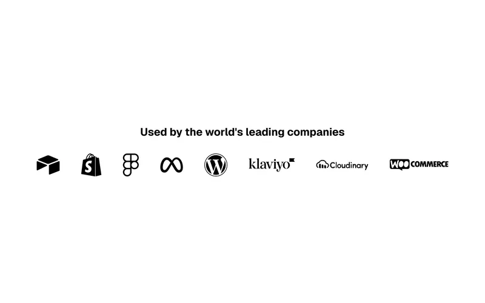
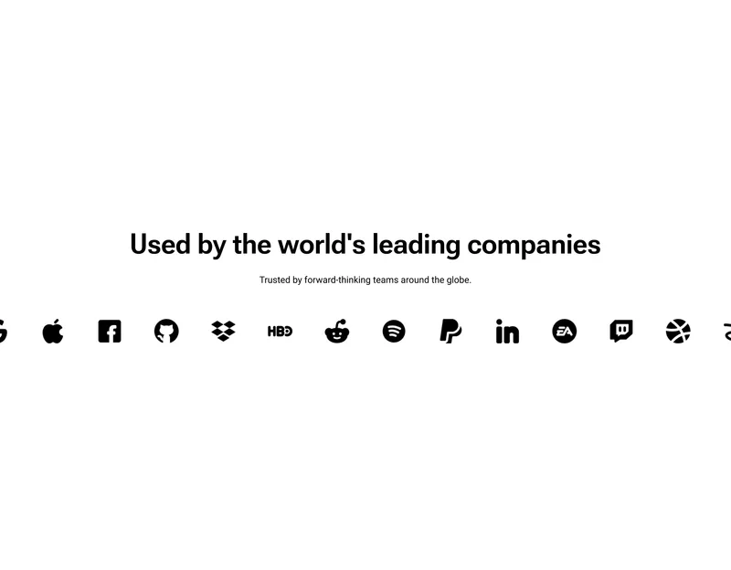
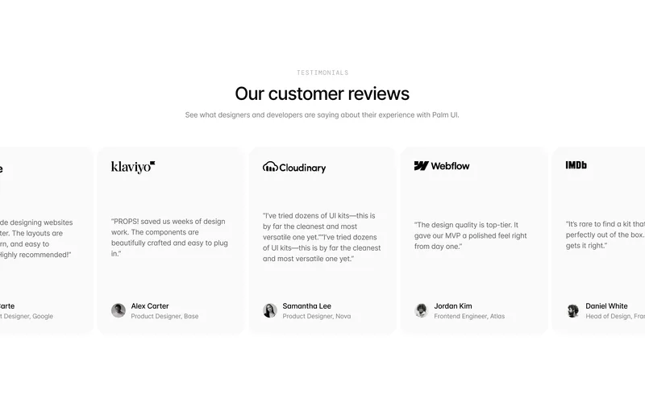
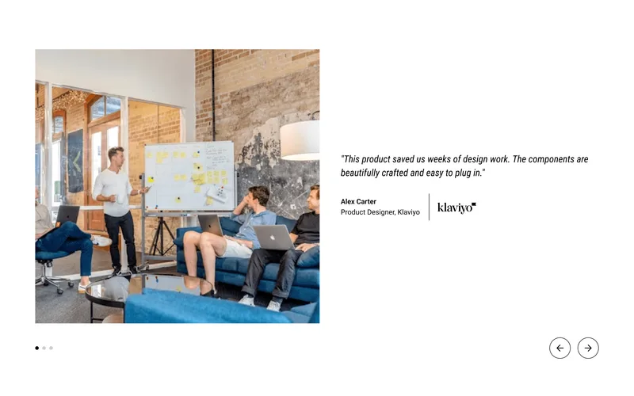
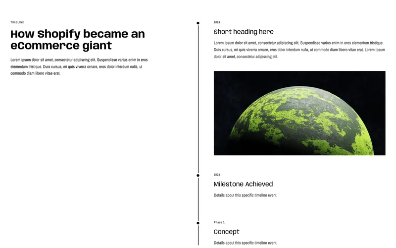
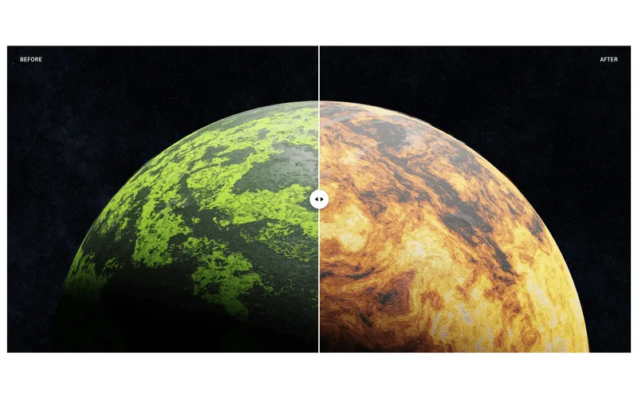
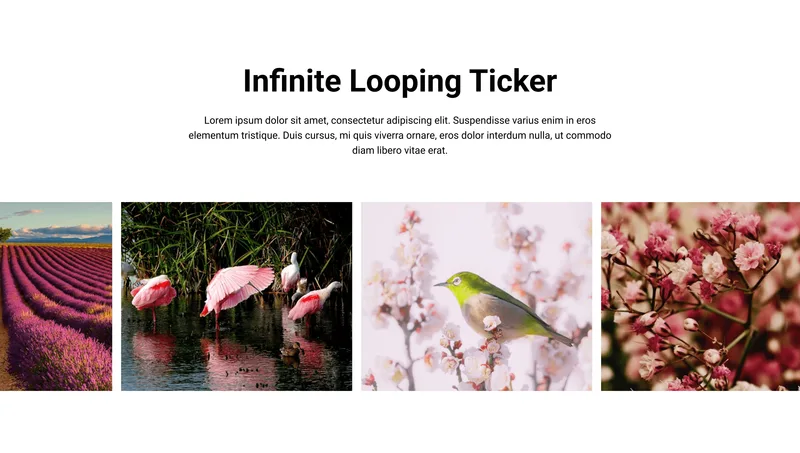

<a href="https://props.tools/shopify"><picture><source media="(prefers-color-scheme: dark)" srcset=".github/hero-dark.svg"></picture></a>

PROPS is a free library of Shopify sections. Each section is a single Liquid file that carries its own styles, script and theme editor settings, so adding one to a store is a copy and a paste. No apps, no build step, no monthly fee.

**[Browse the library](https://props.tools/shopify)** · **[Install guide](https://props.tools/how-to)** · **[Report a theme issue](https://github.com/hobi-design/props/issues/new/choose)**

<a href="https://props.tools/shopify"><picture><source media="(prefers-color-scheme: dark)" srcset=".github/wall-dark.svg"></picture></a>

## Sections

Each one links to a live preview on the PROPS site and to its code in this repository.

### Hero

<table>
<tr>
<td width="33%" valign="top">
 
<b>Image Collage Hero</b> 
A hero section with scattered, edge-anchored images around text and CTA buttons. 
<a href="https://props.tools/shopify/image-collage-hero">Preview</a> · <a href="sections/hero/props-collage-hero.liquid">Code</a>
</td>
<td width="33%" valign="top">
 
<b>Inline Image Hero</b> 
A hero section with images embedded directly inside the heading text. 
<a href="https://props.tools/shopify/inline-image-hero">Preview</a> · <a href="sections/hero/props-inline-hero.liquid">Code</a>
</td>
<td width="33%" valign="top">
 
<b>Video Background Hero</b> 
A full-width hero section with a background image or video. 
<a href="https://props.tools/shopify/video-background-hero">Preview</a> · <a href="sections/hero/props-bg-media-hero.liquid">Code</a>
</td>
</tr>
</table>

### Gallery

<table>
<tr>
<td width="33%" valign="top">
 
<b>Image Gallery Grid</b> 
A clean, responsive gallery with customizable layouts. 
<a href="https://props.tools/shopify/image-gallery-grid">Preview</a> · <a href="sections/gallery/props-gallery.liquid">Code</a>
</td>
<td width="33%" valign="top">
 
<b>Image Slider with Text</b> 
A two-column section with a horizontal image slider. 
<a href="https://props.tools/shopify/image-slider-with-text">Preview</a> · <a href="sections/gallery/props-slider-gallery.liquid">Code</a>
</td>
<td width="33%"></td>
</tr>
</table>

### Social Proof

<table>
<tr>
<td width="33%" valign="top">
 
<b>Logo Grid</b> 
Display logos in a responsive grid, in two layouts. 
<a href="https://props.tools/shopify/logo-grid">Preview</a> · <a href="sections/social/props-logos.liquid">Code</a>
</td>
<td width="33%" valign="top">
 
<b>Scrolling Logo Carousel</b> 
Display partner, client, or brand logos in a continuously scrolling ticker. 
<a href="https://props.tools/shopify/logo-carousel">Preview</a> · <a href="sections/social/props-logo-marquee.liquid">Code</a>
</td>
<td width="33%" valign="top">
 
<b>Scrolling Testimonials</b> 
An infinite-scrolling horizontal ticker of testimonial cards. 
<a href="https://props.tools/shopify/scrolling-testimonials">Preview</a> · <a href="sections/social/props-looping-testimonials.liquid">Code</a>
</td>
</tr>
<tr>
<td width="33%" valign="top">
 
<b>Testimonial Slider</b> 
A testimonial slider with image, quote, author info, and logo. 
<a href="https://props.tools/shopify/testimonial-slider">Preview</a> · <a href="sections/social/props-testimonials-slider.liquid">Code</a>
</td>
<td width="33%"></td>
<td width="33%"></td>
</tr>
</table>

### Content

<table>
<tr>
<td width="33%" valign="top">
 
<b>Timeline</b> 
An animated timeline that supports text blocks, images, and links. 
<a href="https://props.tools/shopify/timeline">Preview</a> · <a href="sections/content/props-timeline.liquid">Code</a>
</td>
<td width="33%"></td>
<td width="33%"></td>
</tr>
</table>

### Interactive

<table>
<tr>
<td width="33%" valign="top">
 
<b>Before and After Slider</b> 
An interactive image comparison slider with draggable handle. 
<a href="https://props.tools/shopify/before-after-slider">Preview</a> · <a href="sections/interactive/props-before-after.liquid">Code</a>
</td>
<td width="33%" valign="top">
 
<b>Scrolling Marquee</b> 
Infinite-scrolling horizontal ticker for images, text, or a mix of both. 
<a href="https://props.tools/shopify/scrolling-marquee">Preview</a> · <a href="sections/interactive/props-ticker.liquid">Code</a>
</td>
<td width="33%"></td>
</tr>
</table>

<a href="https://props.tools/how-to"><picture><source media="(prefers-color-scheme: dark)" srcset=".github/flow-dark.svg"></picture></a>

## Add a section to your store

### Copy

1. **Copy the code.** Pick a section above, follow its **Code** link and press GitHub's **Copy raw file** button at the top right of the file. Nothing on your store changes yet.

### Paste

2. **Open the code editor.** In your Shopify admin, go to **Online Store → Themes**, press the **⋯** button beside **Customize** and choose **Edit code**.
3. **Create a file.** In the **Sections** folder, choose **Add a new section** and name it after the file, for example `props-collage-hero`. Shopify adds the `.liquid` ending.
4. **Paste and save.** Replace the starter code Shopify generates with the code you copied, then save.

### Place

5. **Open Customize.** The section now appears under **Add section**.
6. **Customize and publish.** Place it on a page, adjust its settings in the sidebar and save. This is the only part customers will see.

The [install guide](https://props.tools/how-to) shows each step with a screenshot.

## Themes

Sections are written to work in any Online Store 2.0 theme: their own class names carry a `props-` prefix, styles are scoped to the section, and no section loads a library or needs another file from the theme.

We test on Dawn, Shopify's reference theme, and not yet on others. If a section misbehaves in your theme, a [theme report](https://github.com/hobi-design/props/issues/new/choose) tells us where to look, and a report that a section works in a theme we haven't tried is just as useful.

## For developers and AI agents

[`sections.json`](sections.json) lists every section with its category, tags, version, a one-line description and the raw URL of its file. Installing a section programmatically means fetching that one file and saving it to `sections/` in a theme.

## Contributing

Theme reports, bug reports and section requests all help. [CONTRIBUTING.md](CONTRIBUTING.md) explains how each one works and the standard a section is built to.

## License

[MIT](LICENSE). Use the sections in your own store, in client work or inside a theme you sell, and change them however you like. Keep the comment at the top of each file so the license travels with the code.

PROPS is made by [House of Brilliant Ideas](https://www.hobi.design), an agency that does design, strategy and development.
